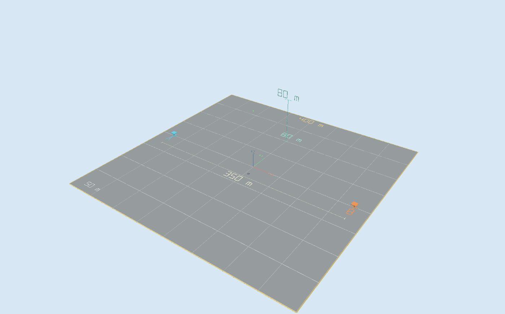

# Red Balloon Interceptor — Phase 1B

Native macOS Gazebo environment for generic simulation and control research.
**The expanded world now runs successfully on this Mac.** Server startup,
Transport discovery, advancing simulation time, repeat startup and both GUI views
were executed and recorded. No aircraft flight or ArduPilot integration is
claimed. Historical Phase 1 evidence remains unchanged.

## World and coordinate convention

- Field: **400 × 400 m**, centered at the origin; x/y limits are -200 to +200 m.
- Ground top: z=0 m; gravity `(0, 0, -9.80665)` m/s²; no wind.
- Local ENU: +X east, +Y north, +Z up; no real GPS origin is assigned.
- Grid: **50 m** spacing, with a visible yellow boundary.
- Passive survey references A/B: **(-175, 0, 0)** and **(175, 0, 0)** m,
  separated horizontally by **350 m**.
- Passive altitude reference: **80 m AGL**, at x=0, y=100 m.
- Generic landing pad, daylight, neutral ground, coordinate axes and geometric
  distance/altitude labels. Only the ground slab and landing pad have collisions.

References are visual measurement aids, not commands, destinations, trajectories,
operational-zone definitions, targets or collision objectives.

The source of configuration is [world_config.yaml](config/world_config.yaml).
It is valid YAML 1.2 written in the JSON-compatible subset so the installed Python
standard library can read it without installing a YAML package. Units and display
styling are explicit. The world and GUI files are generated and checked together:

```bash
python3 scripts/build_world.py          # detect config/SDF/GUI drift
python3 scripts/build_world.py --write  # regenerate after a deliberate config edit
```

## Launch using the existing Gazebo installation

Terminal 1:

```bash
cd "/Users/papajhon/Project/Red Balloon Intercepter/red-balloon-interceptor"
./scripts/launch_world.sh validate
./scripts/launch_world.sh server
```

Terminal 2, choose one view:

```bash
cd "/Users/papajhon/Project/Red Balloon Intercepter/red-balloon-interceptor"
./scripts/launch_world.sh gui       # perspective overview
# Or, after closing that GUI:
./scripts/launch_world.sh topdown   # complete field from above
```

Server and GUI are separate on macOS and share partition `rbi_phase1`. The server
runs with seed 42. Launches save stdout/stderr in unique `logs/<mode>-*/`
directories; the server also records states in their `state/` subdirectory.
Stop with Ctrl-C. One server per partition; do not attach another world to it.
Camera clipping is 5–3000 m for the overview; use a smaller near clip in the
project config if later adding close-up inspection. No shell profile is changed.

## Executed validation and actual screenshots

**26/26 unit tests passed**, including the previous 14 tests with their world-size
expectation updated. WORLD-001 through WORLD-011 passed within the documented
scope. [Full results and performance](docs/phase1b_results.md) include the raw
runtime evidence paths, actual measurements and known warnings.



[Actual top-down render](docs/screenshots/phase1b_topdown.png) ·
[Capture provenance](docs/screenshots/provenance.json)

These are actual, unedited Gazebo GUI viewport captures, not synthetic images or
conceptual diagrams. The GUI window chrome is not captured. The initial camera
shows the complete field. The pictures contain no aircraft or flight result.

Reproduce the checks in a fresh evidence directory:

```bash
python3 -m unittest discover -s tests -v
python3 scripts/validate_world_runtime.py --output-dir logs/runtime_new \
  --duration 10 --repetitions 2
python3 scripts/validate_world_runtime.py --output-dir logs/gui_new \
  --duration 10 --repetitions 1 --gui perspective
```

## Monitoring and offline analysis

The original read-only Gazebo/MAVLink monitors, CSV schema, synthetic fixture and
analysis remain available. The environment-only world has no dynamic aircraft
odometry topic. See [monitoring documentation](companion/monitoring/README.md).

```bash
python3 analysis/generate_synthetic_data.py --output logs/synthetic_new.csv
python3 analysis/plot_flight_data.py logs/synthetic_new.csv --output-dir plots/synthetic_new
open plots/synthetic_new/index.html
```

The existing `plots/synthetic_demo/` is explicitly **synthetic test data**. It
validates plotting, not real simulation performance or aircraft stability. The
legacy sphere experiment remains a separate 100 m physics fixture, unchanged;
it is not the 400 m mission field and has not been reclassified as a flight test.

## ArduPilot status and files

Native ARM64/Harmonic support is documented upstream, and the existing CMake /
Clang successfully built and ran a C++17 smoke test. A local dependency-discovery
probe found the Gazebo libraries and RapidJSON, then stopped at missing OpenCV.
GStreamer and required ArduPilot Python modules are also absent. **No actual
plugin or SITL build/flight has passed.** Python 3.15 compatibility with that
complete stack remains unverified. See [compatibility assessment](docs/sitl_compatibility.md).
No system package or Python upgrade was performed.

| Path | Purpose |
| --- | --- |
| `config/world_config.yaml` | Central dimensions, environment and view configuration |
| `simulation/worlds/rbi_phase1.sdf` | Expanded generated world |
| `simulation/gui/*.config` | Reusable perspective and top-down views |
| `scripts/build_world.py` | Standard-library world/view generator and drift check |
| `scripts/launch_world.sh` | Native launch with evidence logging |
| `scripts/validate_world_runtime.py` | Bounded isolated startup, clock, topics and performance |
| `tests/test_world.py`, `tests/test_runtime_helpers.py` | Geometry/config/non-collision and runtime parser checks |
| `analysis/`, `companion/`, `control_research/` | Preserved analysis/monitoring workflows |
| `config/hardware_reference.yaml` | Unchanged BOM, with unmeasured parameters still null |
| `docs/` | Architecture, plans, reports, commands and screenshot provenance |

[Architecture](docs/architecture.md) · [Test plan](docs/test_plan.md) ·
[Environment](docs/environment_report.md) · [Command record](docs/phase1b_commands.md)
