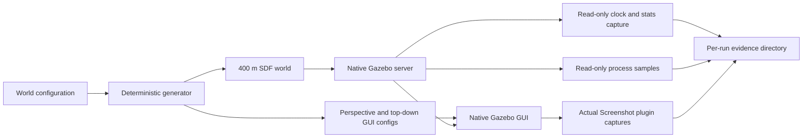
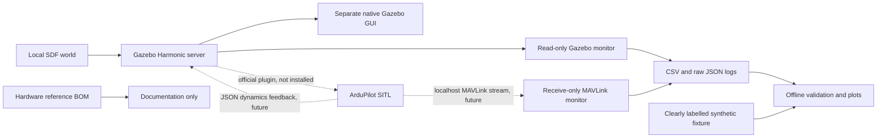

# Architecture

## Phase 1B implementation and verified boundary

The main world is now 400 × 400 m with a 50 m grid, passive references 350 m
apart, and an 80 m AGL visual scale. `config/world_config.yaml` centralizes the
dimensions, local ENU convention, gravity, no-wind setting, daylight and camera
views. It uses the JSON-compatible YAML 1.2 subset to avoid installing a parser.
`scripts/build_world.py` generates the SDF and two GUI XML fragments; independent
geometry tests plus byte comparison detect drift. The physics fixture remains
separate and unchanged. No operational zone or flight path is inferred.

The following is a **conceptual architecture diagram**, not a simulation result:

`validate_world_runtime.py` creates a new Gazebo partition for every run, binds
Gazebo to localhost, records separate stdout/stderr, checks topic discovery and
clock progression, samples owned process groups and performs bounded shutdown.
The only service request in GUI validation is `/gui/screenshot`, which saves a
view image and cannot command an aircraft. CPU figures come from macOS `ps` and
are process-lifetime averages, not whole-machine utilization. Raw samples remain
available for audit. The launcher independently records server states.

World, Transport, clock and both views are now locally verified. The initial
runtime restriction was session-specific; it was not fixed by reinstalling
Gazebo or disabling protection. Current execution permissions already allowed
local sockets. ArduPilot integration remains a separate unverified boundary.
See [actual results](phase1b_results.md) and [capture provenance](screenshots/provenance.json).

The baseline is a native macOS Gazebo Sim 8 server with DART physics and a separate
Gazebo GUI. Python scripts handle observation and post-processing. No new C++
plugin is needed for Phase 1: the installed physics, scene broadcaster, and
odometry publisher cover the current environment and test fixture.

The controller and physics exchange data only when the official Iris integration
is installed. The monitoring processes do not participate in control. Gazebo
monitoring calls only `gz topic -e --json-output`; it never publishes or calls
services. The optional MAVLink monitor binds only `127.0.0.1`, decodes received
packets, and has no transmission call. It does not send stream requests or
heartbeats. Startup, modes, and any later simulated flight belong to the upstream
SITL operator workflow, not to the companion observer.

Coordinates are explicitly recorded as world ENU (+X east, +Y north, +Z up) and
body FLU. For the flat baseline, east/north are chosen axis labels, not a GPS
calibration. Gazebo `OdometryPublisher` reports body-frame twist, so the monitor
rotates linear velocity using the reported quaternion. MAVLink NED position and
velocity are permuted/sign-corrected; FRD attitude is converted to ENU/FLU. These
frame transforms have unit tests. Arbitrary odometry frames are rejected.

Gazebo odometry is simulation truth with a numerically estimated, smoothed twist;
MAVLink local position is an estimator output. Their origins and timestamps must
be aligned before comparing them. Their CSV sources are kept separate, and no
automatic truth/estimate fusion is performed.

Each live recording has raw evidence plus normalized CSV. Stats health and FCU
heartbeat health remain distinct. A pause, missing message, or frozen simulator
must never be called an autopilot failsafe without FCU evidence. The parser
rejects non-finite values, non-increasing time, and mixed source labels. Metrics
are descriptive over the selected window; missing references yield null errors,
not invented zero error. No thresholds are inferred from the real hardware BOM.

All mutable outputs stay in the project or temporary paths. Existing Homebrew
software, shell profiles, user Gazebo configuration, and the spreadsheets were
not edited. Launching Gazebo from a normal user Terminal may cause Gazebo itself
to create its usual user cache/config files; the launcher does not replace them.
