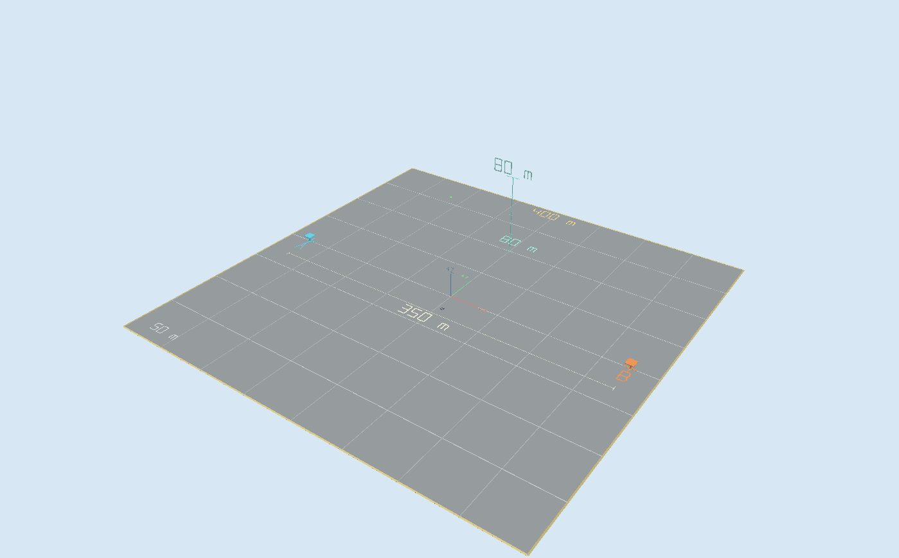
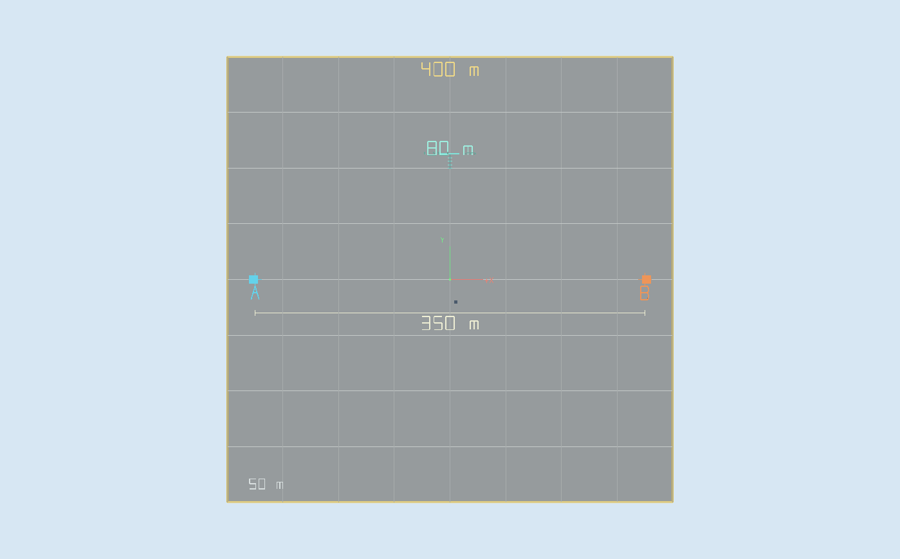

# Phase 1B execution report

Work began 2026-11-26 and final validation completed 2026-11-27, Asia/Bangkok.
Evidence root: `logs/phase1b-20261126T220119/` (named for the beginning of work).
These are actual runtime observations, not synthetic data or flight results.

## Acceptance results

| Test | Status | Evidence / scope |
| --- | --- | --- |
| WORLD-001 SDF syntax | PASS | Installed `gz sdf -k` returns `Valid.`; unit suite and legacy validator |
| WORLD-002 Field dimensions | PASS | Ground visual and collision both 400 × 400 m; top surface z=0; config agreement |
| WORLD-003 Reference separation | PASS | Static A/B world poses (-175,0,0)/(175,0,0): horizontal distance 350 m |
| WORLD-004 Altitude reference | PASS | Reference top at world z=80 m above z=0 ground |
| WORLD-005 Ground grid | PASS | 18 lines total, 50 m spacing, complete field; extra Gazebo default grid disabled |
| WORLD-006 Non-collidable references | PASS | All models static; exactly two collision elements, only in ground and pad |
| WORLD-007 Runtime loading | PASS | Final headless and GUI runs load main SDF and DART without server errors; clean shutdown |
| WORLD-008 Clock progression | PASS | Final repeated headless runs contain 9,955 and 9,987 strictly increasing clock samples |
| WORLD-009 Topics | PASS | World clock/stats discovered and received; 100 stats messages per final 10 s observation |
| WORLD-010 Repeatable startup | PASS | Two isolated headless launches with identical final SDF hash and seed 42 both pass startup, clock and topics |
| WORLD-011 GUI visualization | PASS | Final perspective and top-down renders visually inspected; complete field and references visible; both GUI processes alive before requested shutdown, exit 0 |

**26/26 unit tests PASS:** the previous 14 tests plus 10 world/config checks and
2 runtime evidence-parser tests. The existing baseline geometry test now expects
400 m / 18 lines, preserving its purpose after the intentional specification
change. Source originals are saved under the evidence `before/` directory.
`unit_tests_final.txt` is the final execution output. The original sphere SDF
also still validates. Shell syntax and Python compilation pass.

The old `validate_phase1.py` was rerun in `legacy_validator/`: baseline SDF,
physics-fixture SDF, loopback and bounded server-load checks all pass now. This
does not execute the sphere free-fall analysis or change historical hover/failsafe
statuses. The public server launcher was separately exercised for 50 iterations;
its stdout/stderr and command record are retained.

## Actual performance measurements

Measured on the existing M4 Pro / 24 GiB / macOS 27.0.1 native installation.
Final measurements are short static-world observations; they do not estimate
Iris, camera, AI inference, or real-hardware flight performance.

| Final run | Discovery latency (s) | Sim advance during requested 10 s capture | RTF mean (min…max) | Server CPU mean* | Server peak RSS (MiB) |
| --- | ---: | ---: | --- | ---: | ---: |
| Headless 1 | 4.689 | 9.954 s | 1.020 (0.904…2.684) | 13.58% | 186.72 |
| Headless 2 | 4.681 | 9.986 s | 0.998 (0.901…1.011) | 13.20% | 187.17 |
| Perspective GUI attached | 4.689 | 10.000 s | 0.999 (0.985…1.008) | 6.42% | 187.78 |
| Top-down GUI attached | 4.680 | 9.997 s | 0.999 (0.989…1.040) | 6.80% | 188.09 |

| GUI process group | CPU mean* | Peak RSS (MiB) | Stability observed |
| --- | ---: | ---: | --- |
| Perspective | 25.93% | 386.66 | Alive over capture interval, saved final image, exit 0 on shutdown |
| Top-down | 25.13% | 386.56 | Alive over capture interval, saved final image, exit 0 on shutdown |

\* CPU samples are macOS `ps` process-lifetime averages, sampled every 0.5 s and
summed over the owned process group. The displayed mean averages those samples;
it is **not instantaneous CPU load or percent of the entire M4 Pro**. Startup
samples are included. RSS is summed resident memory, not unique/physical memory
accounting. CLI subscribers and unrelated applications are outside these groups.

Discovery latency includes launching the `gz topic -l` probe, not just server
initialization. The RTF maximum 2.684 is an observed short transient, not a
sustained speed claim; simulation advance over the full window remains near real
time. Initial experiments on 2026-11-26 overlapped a pre-existing shapes server;
it was absent before the accepted final runs on 2026-11-27. These are observation
samples, not a controlled thermal/endurance benchmark. No GPU utilization,
power draw, frame rate or long-term GUI stability was measured.

## Actual GUI images and limitations

Images are unedited PNGs saved by the installed Gazebo Screenshot plugin from
the actual user camera. [Provenance and SHA-256](screenshots/provenance.json)
link them to the raw run and final world hash. They exclude the GUI window chrome.
Distance and altitude labels use simple stroke geometry. Landing-pad detail is
small at the complete-field overview scale; it remains inspectable by zooming.

Metal rendering works. Nonfatal upstream GUI warnings remain: Roboto fallback,
WorldStats QML binding loop, default 8x antialiasing falling back to 1x, and Qt
shader-effect warnings associated with screenshot notification effects. There
were no fatal GUI `[Err]` entries in the accepted runs. We did not reinstall or
patch the installed Gazebo/Qt rendering stack.

Two issues were found and corrected in project tooling/visualization:

- Early screenshot requests could return a black image before scene readiness;
  the validator now also captures after its observation window. Black preliminary
  images remain in evidence and were not accepted as visualization passes.
- A 45 s capture exceeded the reader's 2 MB unparsed-buffer limit when the whole
  file was fed in one call. Chunked parsing and a regression test fixed it. The
  original failure result is preserved; a separate reanalysis confirms 44,696
  increasing clock messages over 44.695 simulated seconds. Final runs passed
  directly with the corrected reader.

The default small 1 m GUI grid caused visual interference at the origin and
contradicted the intended 50 m reference grid; the main SDF now explicitly sets
`scene/grid=false` and retains only the custom 50 m lines.

## Remaining boundaries

ArduPilot SITL and the official plugin have not been built or executed locally.
Missing OpenCV/GStreamer and Python prerequisites remain integration blockers.
CMake/Clang C++17 smoke execution and dependency discovery are documented
separately in [the compatibility report](sitl_compatibility.md); they are not
substitutes for a full build. No additional package was installed and no physical
FC/Raspberry Pi or other aircraft hardware was contacted.

No actual aircraft hover, failsafe, collision, target navigation or autonomous
flight test was performed. The 80 m reference and 350 m separation are passive
scene annotations. The pre-existing synthetic analysis examples remain synthetic.

Raw evidence locations under the evidence root:

- `final_runtime/run_01/`, `run_02/`: server, topic/clock/stats and CPU/RSS evidence.
- `final_perspective/run_01/`, `final_topdown/run_01/`: GUI logs, samples and captures.
- `old_process_cleanup.json`: confirmed termination of the earlier owned diagnostic.
- `dependencies.json`, `compiler_probe/`, `plugin_dependency_probe/`: compatibility evidence.
- `before/`, `preservation_before.json`, `preservation_after.json`: prior files and integrity checks.
- [Commands](phase1b_commands.md) and [current file manifest](phase1b_file_manifest.json).
